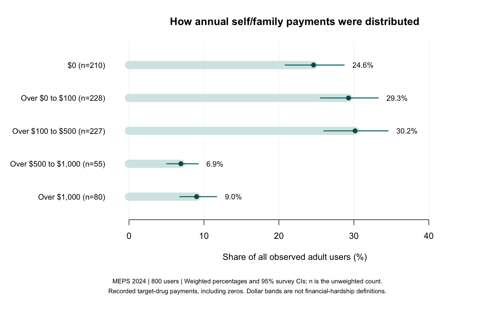

# Medication Payments in MEPS

**GLP-1 receptor agonists and tirzepatide | Public-use survey data | Python, SQL and R**

A reproducible analysis of who paid for GLP-1 receptor agonists and tirzepatide, and how annual self/family payments varied among adults with recorded use. The project links person-level and prescription records from the Medical Expenditure Panel Survey (MEPS), aggregates medication payments within each person, and estimates payer contributions and spending distributions under the complex survey design.

[Read the results](results/research-brief.md) · [Methods](METHODS.md) · [Data sources](SOURCES.md)

## Research question

How are recorded medication payments divided across patients and payers, and what do means, quantiles and payment bands reveal about users' annual out-of-pocket spending?

The population includes adult users of the target medicines regardless of indication; it is not restricted to people with diagnosed diabetes. The data describe 2024 and were released in 2026.

## Analysis

- Link AHRQ person and prescription files; audit exact ingredient and brand mappings and exclude insulin combinations.
- Aggregate repeated prescription records with SQL while retaining users with zero self/family payments.
- Estimate payer shares, annual mean payments, weighted quantiles and payment-band proportions using survey weights, strata and primary sampling units.
- Apply measure-specific precision rules and preserve reasons for withholding estimates.
- Reconstruct selected weighted estimates and survey variances independently and reconcile payment components and denominators.
- Examine age, annual coverage and monthly insurance histories as supplementary descriptive analyses.



## Interpretation

These are observed, edited/imputed survey payments. They do not establish prescription denials, income-relative affordability, treatment effectiveness or a causal effect of insurance. Annual totals are not standardized full-year treatment prices. Monthly insurance histories cannot date each prescription acquisition.

## Repository

| Location | Contents |
| --- | --- |
| [Results](results/research-brief.md) | Main report, figures and aggregate tables |
| [Methods](METHODS.md) | Cohort definitions, inference, reporting rules and field dictionary |
| [Sources](SOURCES.md) | Official documentation and data provenance |
| [Scripts](scripts/) and [SQL](cohort.sql) | Download, preparation, survey analysis and verification |
| [Tests](tests/) | Deterministic checks of classification, aggregation and payment methods |
| [SAS implementation](sas/) | DATA step, PROC SQL and PROC SURVEYMEANS source for the main analysis |

The [age supplement](results/extension-note.md) and [coverage appendix](results/coverage-appendix.md) retain secondary findings. All published data tables are aggregates; downloaded microdata and person-level intermediates stay local.

## Reproduce

Install Python and R. The reference environment used Python 3.12, pandas 2.2.3, R 4.1.1, survey 4.5 and jsonlite 1.7.2; other versions must pass the included checks. Run these commands one line at a time in Terminal:

```sh
git clone https://github.com/CJisAgirl/meps-medication-payments.git
cd meps-medication-payments
python3 -m venv .venv
source .venv/bin/activate
python -m pip install -r requirements.txt
mkdir -p .Rlib
export R_LIBS_USER="$PWD/.Rlib"
Rscript -e 'install.packages(c("survey", "jsonlite"), repos="https://cloud.r-project.org")'
python run.py
```

The runner checks tests, downloads the official files when absent, verifies pinned source hashes, prepares records, runs the survey analyses, independently checks results, and writes the reports. An error stops the run. Successful completion ends with `Complete. Read results/research-brief.md.`

Open the local [report](results/research-brief.md) and check that [payment verification](results/payment-verification.json) reports `PASS`. The [source manifest](results/source-manifest.json) records source fingerprints; [R-session.txt](results/R-session.txt) records the R environment. An existing R library can be selected with `R_LIBS_USER`; `MEPS_RSCRIPT` can specify an alternative Rscript executable. No API key or restricted claims license is required.

## Methods demonstrated

An optional [SAS version](sas/README.md) reconstructs the main cohort and provides survey estimates and reference comparisons. The published result tables are generated by the Python/SQL/R workflow; the SAS program includes comparisons against those reference estimates.

Public health data management, SQL aggregation, complex survey inference, weighted distribution analysis, data quality checks, reproducible reporting and interpretation of observational evidence.
