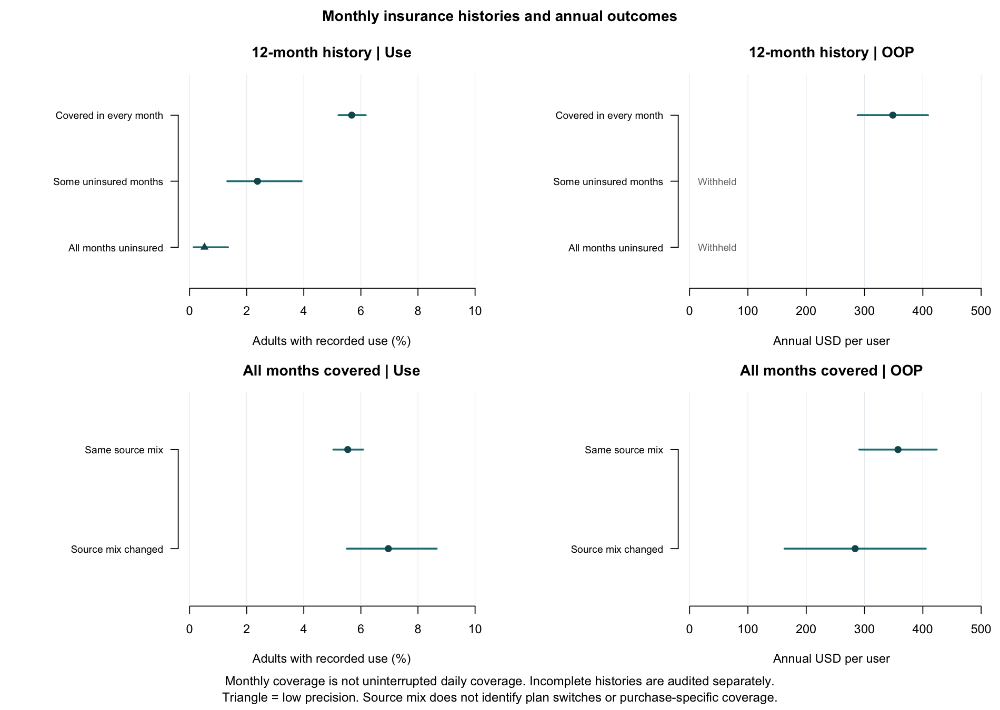

# Appendix: monthly insurance histories

These descriptive histories cannot date every refill or establish drug-specific reimbursement. Read the [main payment report](research-brief.md) for observed payment sources.

All descriptive means, ratios and person proportions use one AHRQ-based reporting framework. Require at least 60 unweighted people in the relevant analysis denominator, positive survey-design degrees of freedom, and finite estimates and uncertainty. For observed-use proportions the denominator is adults; for conditional spending and payer amounts/ratios it is medication users, including zero payments. Positive-payer counts remain diagnostics, with no separate minimum. RSE below 30% is reportable; 30% through 50% is displayed with an asterisk; above 50% is withheld. Only person proportions can use the AHRQ rare-proportion exception (95% upper bound at most 10%, displayed with an asterisk). A payer share is a ratio of dollars and never uses that exception. Boundary/degenerate estimates require review. An asterisk indicates limited precision, not statistical significance. No records are removed because an estimate is withheld.

## Complete monthly histories

All 12 monthly insurance indicators must be explicitly known. Coverage at some time in every month does not establish coverage on every day. Unknown and out-of-scope values are never converted to uninsured. 195 adults, including 2 users, have incomplete histories and are excluded only from these complete-history comparisons; they remain in the main cohort. 195 incomplete histories include out-of-scope months.

| Monthly history | Sample users / adults | Observed use, % (95% CI) | Annual OOP per user, USD (95% CI) |
| --- | ---: | ---: | ---: |
| Covered in every month | 764 / 12686 | 5.68 (5.22–6.17) | 349 (288–409) |
| Some fully uninsured months | 29 / 1194 | 2.38 (1.32–3.92) | Withheld: denominator n < 60 |
| Uninsured in all 12 months | 5 / 1051 | 0.52 (0.14–1.35)* | Withheld: denominator n < 60 |

## Source combinations among people covered in every month

Preserve simultaneous private, TRICARE/CHAMPVA, Medicare, Medicaid/SCHIP, VA and other public sources. A changed combination is not necessarily a lapse in coverage, and a constant combination does not exclude a change of plan within one source type.

| Source history | Sample users / adults | Observed use, % (95% CI) | Annual OOP per user, USD (95% CI) |
| --- | ---: | ---: | ---: |
| Same source mix each month | 661 / 11253 | 5.54 (5.04–6.08) | 357 (291–424) |
| Source mix changed | 103 / 1433 | 6.96 (5.51–8.66) | 284 (163–405) |

Triangles and asterisks indicate limited precision. Withheld values are not zero. A use proportion can be displayed while the corresponding user-only spending mean is withheld because their denominators differ.

PURCHRD identifies a survey round; RXBEGMM/RXBEGYRX identify first use and can carry forward across records. They cannot date every refill. Annual payments are not spread evenly across months. These results do not identify formularies, denials, unmet need or causal effects.

Sources: [HC-256 insurance](https://meps.ahrq.gov/data_stats/download_data/pufs/h256/h256doc.shtml), [HC-254A timing](https://meps.ahrq.gov/data_stats/download_data/pufs/h254a/h254adoc.shtml), [AHRQ precision](https://meps.ahrq.gov/survey_comp/precision_guidelines.shtml).
