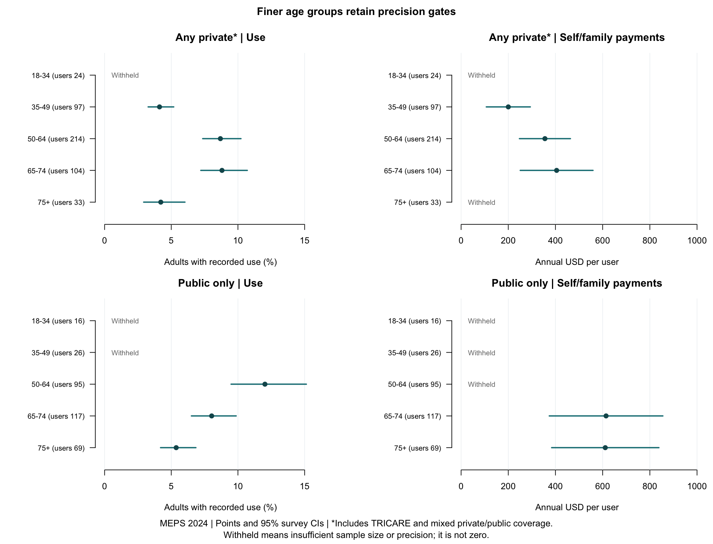
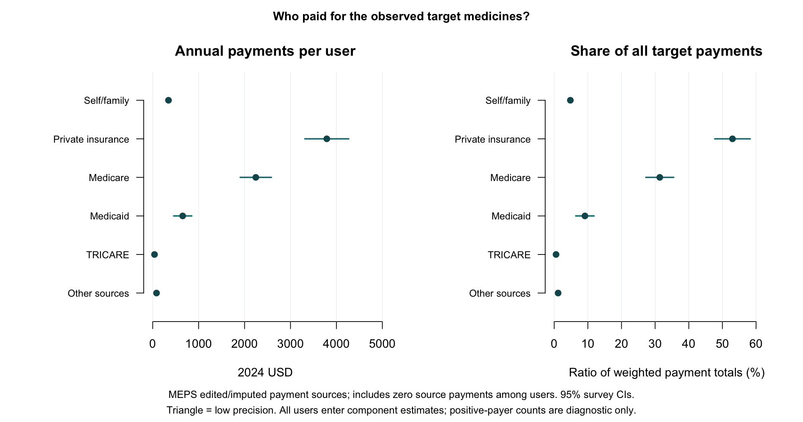

# Supplementary age, insurance and payment analyses

These exploratory analyses extend the [main payment report](research-brief.md) to age and insurance subgroups. The questions were developed after reviewing initial results; their sequence is documented in [Methods](../METHODS.md#analysis-sequence).

## Reporting framework

Estimates follow the [reporting framework](../METHODS.md#reporting-framework). Asterisks and triangular plot markers denote limited precision. Withheld estimates are identified by their sample-size or precision criterion.

## Age and annual coverage

Age groups were 18–34, 35–49, 50–64, 65–74 and 75+. Under the MEPS definition, any-private annual coverage includes TRICARE/CHAMPVA and mixed private/public coverage. Use proportions are estimated among all adults in each group; spending means are estimated among medication users, including zero payments.

| Age | Annual coverage | Sample users / adults | Observed use, % (95% CI) | Annual OOP per user, USD (95% CI) |
| --- | --- | ---: | ---: | ---: |
| 18-34 | All coverage | 41 / 3163 | 1.45 (1.00–2.03) | Withheld: denominator n < 60 |
| 18-34 | Any private incl. TRICARE | 24 / 2028 | 1.26 (0.75–1.98) | Withheld: denominator n < 60 |
| 18-34 | Public only | 16 / 758 | 2.59 (1.35–4.49) | Withheld: denominator n < 60 |
| 18-34 | Uninsured all year | 1 / 377 | 0.45 (0.01–2.56)* | Withheld: denominator n < 60 |
| 35-49 | All coverage | 126 / 3361 | 3.68 (2.97–4.50) | 175 (98–252) |
| 35-49 | Any private incl. TRICARE | 97 / 2357 | 4.12 (3.22–5.19) | 200 (107–293) |
| 35-49 | Public only | 26 / 604 | 3.59 (2.16–5.58) | Withheld: denominator n < 60 |
| 35-49 | Uninsured all year | 3 / 400 | 0.80 (0.14–2.47)* | Withheld: denominator n < 60 |
| 50-64 | All coverage | 310 / 3652 | 8.63 (7.45–9.93) | 326 (237–414) |
| 50-64 | Any private incl. TRICARE | 214 / 2581 | 8.68 (7.30–10.23) | 355 (247–463) |
| 50-64 | Public only | 95 / 790 | 12.02 (9.34–15.15) | 192 (44–339)* |
| 50-64 | Uninsured all year | 1 / 281 | 0.18 (0.00–1.03)* | Withheld: denominator n < 60 |
| 65-74 | All coverage | 221 / 2815 | 8.35 (7.19–9.64) | 514 (370–658) |
| 65-74 | Any private incl. TRICARE | 104 / 1192 | 8.80 (7.14–10.71) | 405 (251–559) |
| 65-74 | Public only | 117 / 1613 | 8.03 (6.43–9.87) | 614 (374–855) |
| 65-74 | Uninsured all year | 0 / 10 | Withheld: denominator n < 60 | Withheld: denominator n < 60 |
| 75+ | All coverage | 102 / 2135 | 4.93 (3.97–6.05) | 549 (376–722) |
| 75+ | Any private incl. TRICARE | 33 / 751 | 4.21 (2.83–6.02) | Withheld: denominator n < 60 |
| 75+ | Public only | 69 / 1379 | 5.37 (4.13–6.85) | 611 (384–838) |
| 75+ | Uninsured all year | 0 / 5 | Withheld: denominator n < 60 | Withheld: denominator n < 60 |

## Monthly histories

The [coverage appendix](coverage-appendix.md) presents annual outcomes by monthly insurance history and describes the timing limitations of these measures.

## Recorded payment sources

Ten edited/imputed source-payment fields were aggregated within person. Other sources combine VA/CHAMPVA, other federal, state/local, workers' compensation and other insurance. Means include all adult medication users, including zero payments; shares are ratios of weighted source totals to total payments. Counts indicate users with positive payments from each source and may overlap.

| Payment source | Users with positive payment | Annual USD per user (95% CI) | Share of payments, % (95% CI) |
| --- | ---: | ---: | ---: |
| Self/family | 590 | 343 (286–400) | 4.80 (4.08–5.52) |
| Private insurance | 351 | 3,790 (3,313–4,268) | 52.99 (47.72–58.26) |
| Medicare | 307 | 2,245 (1,906–2,583) | 31.38 (27.24–35.52) |
| Medicaid | 102 | 653 (456–850) | 9.13 (6.41–11.85) |
| TRICARE | 20 | 39 (17–61) | 0.54 (0.24–0.85) |
| Other sources | 41 | 83 (45–120) | 1.16 (0.62–1.69) |

Payment shares retain the all-source denominator when individual estimates are withheld. Manufacturer rebates are not captured. The survey records support payment estimates rather than claim-level adjudication or denial assessment.

## Age-adjusted association

A survey-weighted quasibinomial model included a natural age spline (3 df) and annual coverage, without an interaction. Predictive margins were standardized to the combined weighted population of adults with any-private or public-only coverage. Uninsured adults were retained in descriptive analyses and excluded from this model.

Model feasibility required at least 100 adults, 5 users and 5 nonusers per coverage-by-age cell, together with convergence, full rank and finite covariance. These checks were specified for the pooled spline model separately from descriptive reporting criteria.

| Group or comparison | Metric | Estimate (95% CI) |
| --- | --- | ---: |
| Any private incl. TRICARE | Age-adjusted use, % | 4.99 (4.51–5.51) |
| Public only | Age-adjusted use, % | 6.02 (5.19–6.97) |
| Public only minus any private | Difference, percentage points | 1.03 (-0.01–2.08) |

Marginal percentages use the shared denominator and precision criteria with model-based logit-delta intervals. The public-minus-private contrast incorporates covariance between margins and is reported when both margins meet the reporting criteria; no RSE threshold is applied to the signed contrast. Adjustment is limited to age. Disease burden, indication, income, medication mix and selection remain potential sources of confounding. The estimates represent age-adjusted associations; spending was not modeled.

## Checks

There are 122 descriptive rows: 65 displayed without a flag, 13 displayed with a precision flag and 44 withheld. Independent calculations reconstruct 120 weighted points and full-design Taylor standard errors. See [design audit](extension-design-audit.json), [cohort audit](extension-cohort-audit.json), [aggregate estimates](extension-estimates.csv), [model support](age-adjustment-support.csv) and [adjusted results](age-adjusted-use.csv).

## Payer components by age

Age-specific means include all medication users within each group, including zero payments from the source. Reporting follows the shared precision framework.

### 18-34

| Payment source | Users with positive payment | Annual USD per user (95% CI) | Share of payments, % (95% CI) |
| --- | ---: | ---: | ---: |
| Self/family | 23 | Withheld: denominator n < 60 | Withheld: denominator n < 60 |
| Private insurance | 24 | Withheld: denominator n < 60 | Withheld: denominator n < 60 |
| Medicare | 1 | Withheld: denominator n < 60 | Withheld: denominator n < 60 |
| Medicaid | 16 | Withheld: denominator n < 60 | Withheld: denominator n < 60 |
| TRICARE | 0 | Withheld: denominator n < 60 | Withheld: denominator n < 60 |
| Other sources | 1 | Withheld: denominator n < 60 | Withheld: denominator n < 60 |

### 35-49

| Payment source | Users with positive payment | Annual USD per user (95% CI) | Share of payments, % (95% CI) |
| --- | ---: | ---: | ---: |
| Self/family | 97 | 175 (98–252) | 2.66 (1.50–3.82) |
| Private insurance | 89 | 5,063 (3,968–6,158) | 76.98 (67.39–86.57) |
| Medicare | 6 | Withheld: RSE > 50% | Withheld: RSE > 50% |
| Medicaid | 26 | 774 (289–1,260)* | 11.77 (4.26–19.29)* |
| TRICARE | 1 | Withheld: RSE > 50% | Withheld: RSE > 50% |
| Other sources | 5 | Withheld: RSE > 50% | Withheld: RSE > 50% |

### 50-64

| Payment source | Users with positive payment | Annual USD per user (95% CI) | Share of payments, % (95% CI) |
| --- | ---: | ---: | ---: |
| Self/family | 221 | 326 (237–414) | 4.34 (3.23–5.45) |
| Private insurance | 190 | 5,356 (4,554–6,158) | 71.30 (64.54–78.06) |
| Medicare | 51 | 788 (454–1,123) | 10.49 (6.30–14.68) |
| Medicaid | 53 | 931 (547–1,315) | 12.39 (7.35–17.43) |
| TRICARE | 10 | Withheld: RSE > 50% | Withheld: RSE > 50% |
| Other sources | 12 | 60 (5–115)* | 0.80 (0.06–1.54)* |

### 65-74

| Payment source | Users with positive payment | Annual USD per user (95% CI) | Share of payments, % (95% CI) |
| --- | ---: | ---: | ---: |
| Self/family | 173 | 514 (370–658) | 6.97 (5.11–8.84) |
| Private insurance | 40 | 1,531 (826–2,235) | 20.79 (11.95–29.63) |
| Medicare | 165 | 4,979 (4,151–5,806) | 67.61 (58.59–76.64) |
| Medicaid | 5 | Withheld: RSE > 50% | Withheld: RSE > 50% |
| TRICARE | 6 | Withheld: RSE > 50% | Withheld: RSE > 50% |
| Other sources | 13 | 95 (6–184)* | 1.29 (0.07–2.51)* |

### 75+

| Payment source | Users with positive payment | Annual USD per user (95% CI) | Share of payments, % (95% CI) |
| --- | ---: | ---: | ---: |
| Self/family | 76 | 549 (376–722) | 6.87 (4.87–8.87) |
| Private insurance | 8 | Withheld: RSE > 50% | Withheld: RSE > 50% |
| Medicare | 84 | 6,859 (5,192–8,527) | 85.89 (79.88–91.89) |
| Medicaid | 2 | Withheld: RSE > 50% | Withheld: RSE > 50% |
| TRICARE | 3 | Withheld: RSE > 50% | Withheld: RSE > 50% |
| Other sources | 10 | 86 (22–151)* | 1.08 (0.19–1.97)* |
